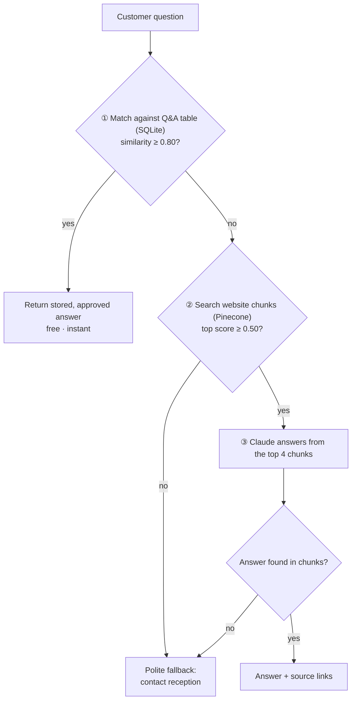

# SQL-First RAG Support Chatbot

A customer support chatbot for a small business website. It answers common questions instantly from a curated Q&A table in SQL, and falls back to retrieval-augmented generation (RAG) over the scraped website when no stored answer fits.

**Runs out of the box on sample data:** `sample-data/` contains the website of *Lantern Lane Yoga*, a fictional studio written for this demo, so you can try the full pipeline without scraping anyone's site. The design decisions and evaluation below come from building and testing the bot on a real small studio's public website; that version isn't published, and no third-party content is included in this repo.

---

## How it works

The cheapest check runs first. Claude is only called when the free checks say it's worth it.

### Pipeline

| Step | What happens | Tools |
|---|---|---|
| 1. Scrape | 16 hand-picked pages fetched politely (robots.txt checked, 1s delay), cleaned of menus/scripts/duplicate blocks, saved as PDFs (15 succeeded; one page reset the connection and was skipped) | `requests`, `BeautifulSoup`, `fpdf2` |
| 2. Generate Q&A | Claude Haiku reads the whole site once and writes Q&A pairs via structured output (asked for 20, returned 22); stored in SQLite, reviewed and edited by hand, plus 2 added manually | `langchain-anthropic`, `pydantic`, `sqlite3` |
| 3. Index | PDFs chunked (1,000 chars, 200 overlap) into 215 chunks, embedded, and stored with source-URL metadata and fixed IDs (re-runs overwrite rather than duplicate) | `bge-base-en-v1.5`, Pinecone |
| 4. Route | SQL-first router with two calibrated thresholds, then Claude Sonnet with a grounded prompt | `numpy`, Claude |
| 5. Chat UI | Simple chat interface showing the route and score for each answer (testing mode) | Gradio |

---

## Design decisions

**Why a Q&A layer in front of RAG?**
Stored answers are approved once and always worded the same way, cost nothing to serve, and return instantly. RAG covers everything else. The Q&A table is deliberately small: every stored answer must be kept up to date, and more stored questions raise the risk of a *similar but different* question being matched.

**Thresholds were measured, not guessed.**

| Comparison | Correct matches | Wrong / off-topic | Threshold |
|---|---|---|---|
| Question ↔ stored question | 0.82 – 0.90 | ≤ 0.69 | **0.80** |
| Question ↔ website chunk | 0.69 – 0.74 | ~0.54 – 0.59 | **0.50** (junk filter only) |

The chunk scores for a real question (0.587) and an off-topic one (0.555) were too close for any threshold to separate reliably, so the RAG threshold only filters obvious junk, and **Claude decides** whether the retrieved text actually answers the question.

**Grounding rules in the prompt.** Answer only from retrieved text; never invent prices, times or policies; link to the live timetable instead of quoting class times; no health-outcome promises; give honest partial answers; and use a fixed fallback when nothing relevant is found.

**Sources on every answer**, so customers can verify and failures can be traced to the page that caused them.

---

## Evaluation

21 test questions covering every route, run before and after tuning:

| Route | Count (final run) |
|---|---|
| Q&A (SQL) | 10 |
| RAG answered | 8 |
| Fallback (nothing relevant) | 3 |

**Issues found in testing and fixed:**

| Problem | Cause | Fix |
|---|---|---|
| Answer cut off mid-sentence | Model's internal reasoning counted toward `max_tokens` | Raised token limit |
| Stored answers quoted class times | Generated before the "no times" rule | SQL `UPDATE` to link to the schedule instead |
| Inconsistent voice ("The studio recommends its…") | Generated Q&A written in the third person | Rewrote stored answers in first person |
| Room-hire question refused despite relevant page | Prompt allowed only full answer or fallback | Added honest partial-answer rule |
| Health question with no caution | No rule for medical topics | Added GP / teacher guidance rule |
| Location and reception-hours questions missed | Gaps in the generated Q&A | Added two Q&A rows (SQL `INSERT` + re-embed) |

Retrieval was tested in isolation (no LLM) before building the chatbot, so that retrieval failures and generation failures could be told apart.

---

## Known limitations

- **No conversation memory.** Each question is answered independently, so follow-ups like "how much is it?" lack context.
- **The Q&A is AI-generated from the website**, not from real customer data. In production, it should be built from the questions customers actually ask (e.g. by logging questions and their routes).
- **Timetable content is loaded by JavaScript** from a booking system and isn't scraped, so the bot links to the schedule page rather than quoting times.
- **The website itself contains some contradictions** (e.g. different postnatal start guidance on two pages). The bot flags these rather than picking one.
- A snapshot scrape goes stale. Production use would need scheduled re-scraping and a way for staff to edit Q&A answers.

---

## Running it

The project is a single Google Colab notebook: `support_chatbot.ipynb`. Click **Open in Colab** above.

1. Get API keys from [Anthropic](https://console.anthropic.com) and [Pinecone](https://www.pinecone.io).
2. In Colab, add them under **Secrets** (🔑) as `Anthropic_API_Key` and `Pinecone_API_Key`, with notebook access enabled.
3. Run the cells in order. With the default `USE_SAMPLE_DATA = True`, Step 1 loads the fictional studio from this repo. Step 2a calls Claude over the whole site once (a few pence); review the generated Q&A before saving it.

To use a real website, set `USE_SAMPLE_DATA = False` in the **Settings** cell and fill in the business name, website, contact phone and pages to scrape. Check the site's `robots.txt` first, and only build a public-facing bot for a business with its permission.

### Repo contents

| Path | What it is |
|---|---|
| `support_chatbot.ipynb` | The full pipeline, step by step |
| `sample-data/` | Website text for the fictional Lantern Lane Yoga (9 pages) |
| `requirements.txt` | Python dependencies |

Dependencies are listed in `requirements.txt`.

---

## Stack

Python · LangChain · Claude (Anthropic) · Pinecone · `BAAI/bge-base-en-v1.5` embeddings · SQLite · Gradio · Google Colab
